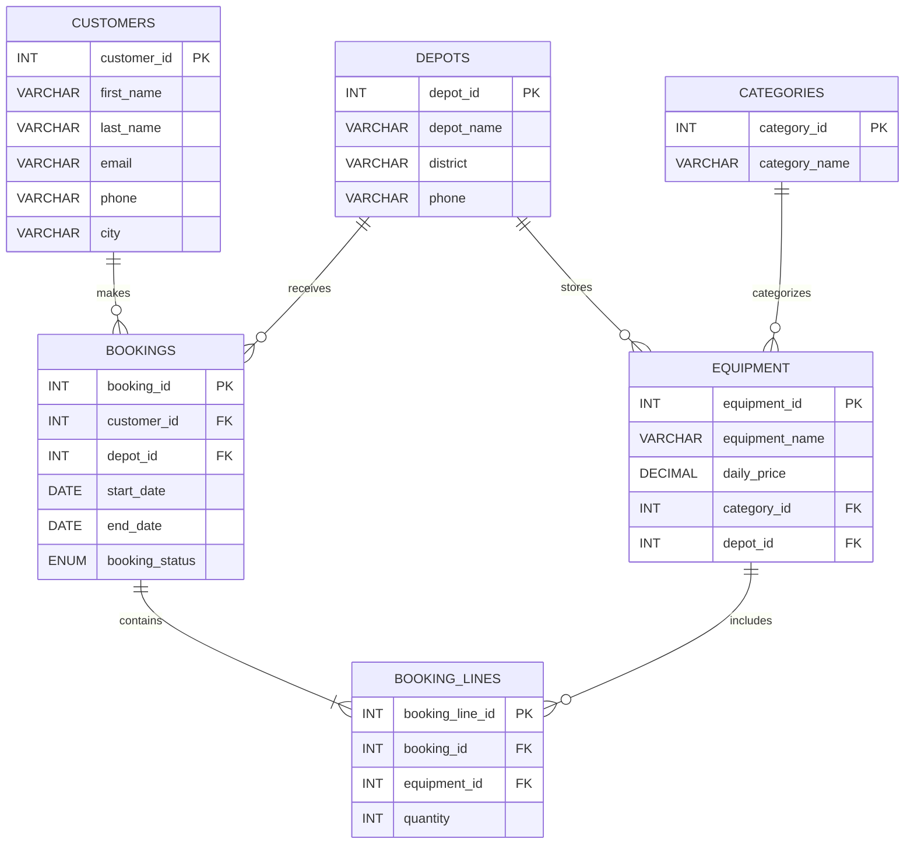

NordicRent – ER Diagram

This document describes the database structure and relationships in the NordicRent database.

Entity Relationship Diagram

### Database Relationships

The database uses primary keys and foreign keys to connect related tables.

- One customer can have many bookings.
- One depot can have many bookings and store many equipment items.
- One category can contain many equipment items.
- One booking can contain multiple booking lines.
- Each booking line refers to one equipment item.

The BOOKING_LINES table handles the many-to-many relationship between BOOKINGS and EQUIPMENT.

### Database Transactions

Transactions are used when creating a booking and its booking lines.

The API uses START TRANSACTION, COMMIT and ROLLBACK to ensure that the booking and its booking lines are handled as one operation.

- COMMIT saves the booking and its booking lines if all operations succeed.
- ROLLBACK cancels the changes if an operation fails.

This prevents incomplete bookings from being saved.

### Database Normalization (1NF–3NF)

The NordicRent database is designed according to the principles of First, Second and Third Normal Form (1NF–3NF).

#### 1NF – First Normal Form

Each column contains atomic values, and each table has a primary key.

**Example:** Customer information is stored in separate columns such as `first_name`, `last_name`, `email` and `phone`.

#### 2NF – Second Normal Form

All non-key attributes depend on the entire primary key.

The tables use single-column primary keys, which means there are no partial dependencies on a composite primary key. 

**Example:** The `BOOKING_LINES` table uses `booking_line_id` as its primary key. A unique constraint on the combination of `booking_id` and `equipment_id` prevents duplicate equipment entries within the same booking.

#### 3NF – Third Normal Form

Non-key attributes depend only on the primary key, not on other non-key attributes.

**Examples:**
- Customer information is stored in `CUSTOMERS`, rather than being repeated in `BOOKINGS`.
- Category names are stored in `CATEGORIES`, rather than being repeated in `EQUIPMENT`.
- Depot information is stored in `DEPOTS` and referenced through foreign keys.

